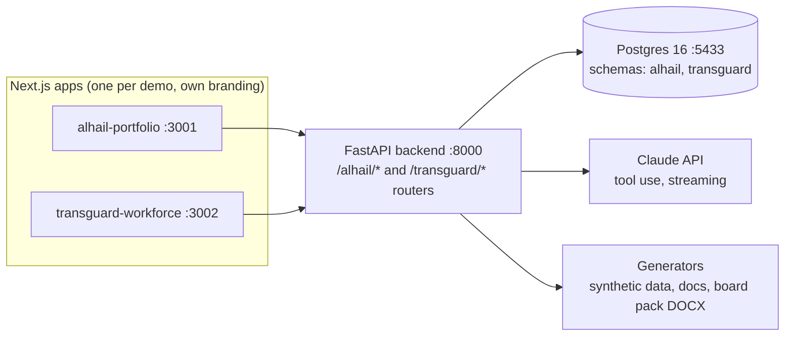

# Development Plan: UAE AI Demos

Two **standalone** demos for the owner meeting (see `docs/07-owner-meeting-demo.md`):

| # | Demo | App | Brand |
|---|---|---|---|
| 1 | **Al Hail Group Portfolio Copilot** | `apps/alhail-portfolio` | Al Hail: navy `#062B49`, silver `#9A9C9F`, sand `#D8C39E`, Manrope |
| 2 | **Transguard Workforce Intelligence** | `apps/transguard-workforce` | Transguard: red `#D71920`, gold `#A2844B`, charcoal, Open Sans |

Demo 1 is built first. Progress is logged in [PROGRESS.md](PROGRESS.md).

## Architecture



| Layer | Choice | Notes |
|---|---|---|
| Front end | Next.js 15 (App Router, TypeScript), Tailwind v4, Recharts | One app per demo, so each demos independently |
| i18n | Small in-house dictionary + `dir="rtl"` toggle | EN / AR; Arabic font IBM Plex Sans Arabic |
| Back end | FastAPI (Python 3.12, venv in `backend/.venv`) | One service, a router per demo |
| Database | Postgres 16 in Docker (`docker-compose.yml`, port 5433) | Separate schema per demo |
| Document search | Postgres full-text search (`tsvector`) | Enough for a ~50-document demo corpus; swap to embeddings later if needed |
| LLM | Claude via Anthropic API (`ANTHROPIC_API_KEY` in `backend/.env`), tool use + streaming (SSE) | Copilot answers only from tool results, with citations |
| Board pack | `python-docx` → DOCX (EN + AR) | |

**Data rule:** every figure is either **public** (with source URL) or **simulated** (labelled in the UI).

## Demo 1: Al Hail Group Portfolio Copilot

| Phase | Scope | Done when |
|---|---|---|
| **0. Foundation** | Repo, docker-compose Postgres, FastAPI skeleton + health check, Next.js app with Al Hail theme, fonts, logo, EN/AR toggle | `docker compose up -d`, backend `/health` OK, app renders branded shell in EN and AR |
| **1. Portfolio data** | 5 sectors, 12 businesses, public facts with sources. Simulated 8 quarters (2024-Q4 to 2026-Q3) of actuals + budget, anchored to public annual figures where they exist, with planted misses. SAMAA loan book. Signals feed. Seeded and reproducible | Seeding twice gives identical tables; planted misses present |
| **2. Cockpit + drill-down** | Cockpit: sector groups, KPI cards, RAG status, flags. Business page: KPI trends, budget variance, signals, sources | All 12 businesses render; SAMAA covenant flag visible |
| **3. Documents** | Generate simulated quarterly source files (management accounts PDF, KPI XLSX) per business; ingest to Postgres FTS with page/cell references | Search returns cited chunks |
| **4. Copilot** | Claude tool-use agent: `query_financials`, `search_documents`, `variance_explain`, `list_signals`, `exposure`. SSE streaming, tool-call cards, citation chips, replies in the question's language | 20-question test set answered correctly with citations, EN and AR |
| **5. Board pack** | Q3 board pack (exec summary, variance commentary per business, risks log, sector pages) in Al Hail branding, EN + AR, every line cited; in-app preview + DOCX download | Every board-pack sentence links to a source |
| **6. Signals + polish** | Signal monitor page, demo reset, offline cache of scripted copilot answers, loading states, rehearsal script | Demo script runs 3× without manual fixes |

**Demo script (target):** cockpit with 12 businesses and 2 amber flags → board pack drafts live, click a citation → ask in Arabic "What is our total Egypt exposure and what changed this quarter?" → SAMAA Finance covenant drill-down.

## Demo 2: Transguard Workforce Intelligence (after Demo 1)

| Phase | Scope |
|---|---|
| 0 | Next.js app with Transguard theme (reuses backend and DB) |
| 1 | Synthetic workforce: 3,000 workers, 120 sites, licences, skills, accommodation, 12 months attendance |
| 2 | Demand forecast + CP-SAT roster (OR-Tools) |
| 3 | No-show model + one-click backfill; coverage map (MapLibre) |
| 4 | What-if ("40 guards for a new mall from 1 Dec") |
| 5 | FM ticket triage (Claude, photos) + multilingual worker assistant |
| 6 | Polish, offline cache, rehearsals |

## Repo layout

```
uae-ai-demos/
├── DEVELOPMENT_PLAN.md · PROGRESS.md · README.md
├── docker-compose.yml          # Postgres 16 on :5433
├── backend/                    # FastAPI
│   ├── app/main.py · app/db.py
│   └── app/alhail/             # router, seed, docs, copilot, boardpack
├── apps/
│   ├── alhail-portfolio/       # Next.js, Al Hail brand
│   └── transguard-workforce/   # (Demo 2)
└── docs/                       # plans, brand kits, logos
```

## How to run

```bash
docker compose up -d                                              # Postgres on :5433
cd backend && .venv/bin/python -m app.alhail.seed                 # seed Al Hail data
.venv/bin/uvicorn app.main:app --port 8000                        # API
cd ../apps/alhail-portfolio && pnpm dev --port 3001               # http://localhost:3001
```
