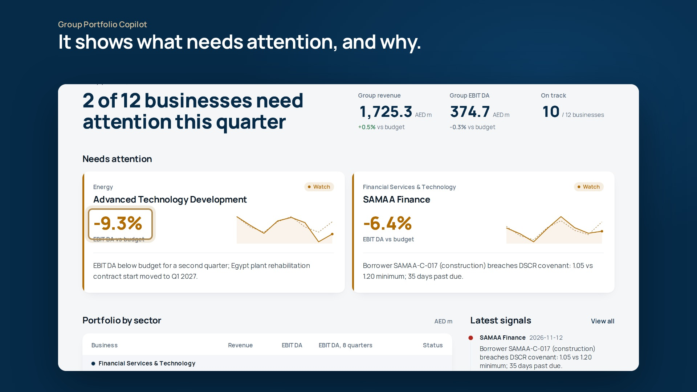

# Al Hail Group Portfolio Copilot (demo)

AI portfolio intelligence demo prepared for Al Hail Holding by NinjaTech: one view of the 12 businesses, a copilot that answers in English or Arabic with every number linked to its source, and a quarterly board pack drafted for the board office.

All quarterly figures, borrowers and documents are simulated; business names and public facts come from alhail.com.

## Links

| | |
|---|---|
| Demo video (22 s) | [brag-output/brag.mp4](brag-output/brag.mp4) ([open on GitHub](https://github.com/bsingh-ninja/al_hail_demo/blob/main/brag-output/brag.mp4)) |
| Live demo | https://al-hail-demo.onrender.com (Arabic: https://al-hail-demo.onrender.com/?lang=ar). The free server sleeps after 15 minutes idle; the first visit then takes about a minute. Local: http://localhost:3001 |
| Code | https://github.com/bsingh-ninja/al_hail_demo |

[](brag-output/brag.mp4)

The video and the app show Al Hail's real brand next to simulated figures. Share them outside NinjaTech only with Al Hail's agreement.

## What we want Al Hail to take away

1. **One view of the whole group.** The 12 businesses across 5 sectors on one screen, with the ones that need attention first and the reason in one line ("2 of 12 need attention this quarter").
2. **Ask anything, in English or Arabic, and see the source.** The copilot must look up the figures and documents before it answers, and every number links to the page it came from; citations the server can't confirm are not shown.
3. **The board pack is drafted, not assembled.** Executive summary, performance against budget, commentary, risks and actions and sector pages, with sources, downloadable as a Word file for the board office to edit.
4. **Risks surface early.** A covenant breach in the loan book or a delayed contract shows up as a signal before the quarter's numbers are final.

In one line: *the board pack in hours rather than weeks, and every figure traceable to its source.*

## Walkthrough for the meeting (about 10 minutes)

| Step | Screen | Do | Say |
|---|---|---|---|
| 1 | Portfolio | Open the app | "Your 12 businesses on one screen. Two need attention: Advanced Technology Development, EBITDA 9.3% under budget for a second quarter, and SAMAA Finance, 6.4% under with a covenant breach." |
| 2 | Business page | Open SAMAA Finance | "Revenue and EBITDA against budget, the loan book exceptions (borrower SAMAA-C-017 breaches its DSCR covenant: 1.05 against 1.20), country exposure and the source PDFs." |
| 3 | Copilot | Ask "What is our total Egypt exposure and what changed this quarter?" | "It looks up the data first. Click any citation to open the source document at that page." |
| 4 | Copilot | Switch to Arabic and ask the same question | "Full Arabic, right to left, same sources." |
| 5 | Board pack | **Draft board pack**, then **Download Word file** | "The quarterly pack drafted from this quarter's figures and documents, every statement linked to its source, ready for the board office to review." |
| 6 | Signals | Filter by severity or business | "Risk and news signals across the portfolio, before they reach the board." |

## Pilot we propose

The board pack copilot on one real quarter's files, in Al Hail's own cloud tenant or on-premises, over 4 to 6 weeks.

## Notes before presenting

- Run `./start.sh --reseed` before the meeting and check that the Gemini key in `backend/.env` works (the copilot and the AI-written summary need it).
- Have an Arabic speaker review the Arabic answers and board pack before the meeting.

## Run

```bash
./start.sh            # database (:5433), API (:8000), web app (:3001)
./start.sh --reseed   # rebuild the demo data and source PDFs first
```

Open http://localhost:3001 (Arabic: http://localhost:3001/?lang=ar). Requires Docker, Python 3.12 and pnpm.

### Gemini key

The copilot and the AI-written board pack summary use Google Gemini. Put your key in `backend/.env` (ignored by git):

```
GEMINI_API_KEY=your-key-here
GEMINI_MODEL=gemini-2.5-flash
```

The key is read on every request, so no restart is needed. Without a key everything else works and the board pack summary uses a template.

## CI

`.github/workflows/ci.yml` runs on every push to `main`, on pull requests and by hand:

- **Web app:** install, lint, type check and production build. Set the repository variable `NEXT_PUBLIC_API_URL` to build against a hosted API.
- **API:** Postgres 16 service, seed the demo data, start the API, then `backend/scripts/smoke.py` checks the demo scenario. No Gemini key is needed in CI; the AI features are not called.

The smoke test also runs against the local demo: `cd backend && .venv/bin/python scripts/smoke.py http://127.0.0.1:8000`. 
## Deploy

Hosted on Render's free plan as the web service `al-hail-demo` (Frankfurt). Render builds the `Dockerfile` and redeploys on every push to `main`. The container runs Postgres, the API and the web app on port 7860; nginx serves the web app and forwards `/api` to the API. The demo data is seeded fresh on every start, so a restart also resets the demo. `GEMINI_API_KEY` is set as an environment variable on the Render service, not in the code. The demo is open (no password); setting `DEMO_PASSWORD` on the service turns on a password prompt (user name `demo`).

Try the container locally:

```bash
docker build -t demo . && docker run --rm -p 7860:7860 -e GEMINI_API_KEY=... -e DEMO_PASSWORD=... demo
```

The same image also runs as a Hugging Face Docker Space (needs a PRO account): `HF_TOKEN=... GEMINI_API_KEY=... DEMO_PASSWORD=... python deploy/hf_space.py <owner>/<space-name>`, or from CI by setting the repository variable `HF_SPACE` and the matching secrets.

## Screens

| Screen | What it does |
|---|---|
| Portfolio | The 12 businesses by sector, flagged businesses first with the reason, EBITDA trend vs budget |
| Business page | Revenue and EBITDA vs budget, KPIs, loan book exceptions, country exposure, source PDFs |
| Copilot | Questions in English or Arabic, answered from the data and documents; every answer must look up the data first, and only server-confirmed citations are shown |
| Board pack | Drafts the quarterly board pack (summary, performance, commentary, risks and actions, sectors) and downloads it as Word |
| Signals | Risk and news signals with severity and business filters |

## Layout

```
backend/   FastAPI + Postgres (app/alhail: seed, documents, copilot, board pack)
web/       Next.js app (Al Hail brand, EN/AR, light/dark)
docs/      plan, brand kit, logo
brag-output/  demo video (brag.mp4), poster, share copy and plan
```
