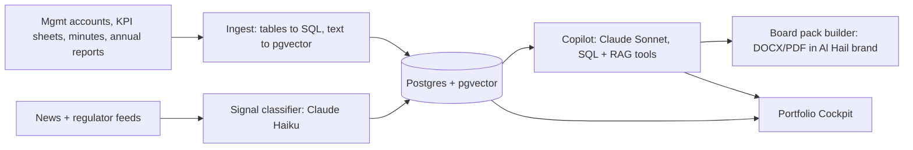

# Plan 3: Al Hail, AI Portfolio Intelligence Copilot

**One line:** A board-level copilot across Al Hail's 12 businesses. It gives one view of portfolio performance, writes the quarterly board pack automatically with sources, monitors risk signals, and answers questions across every report, in English or Arabic.

**Audience:** Al Hail investment leadership / group CFO / board office.
**Key message:** NinjaTech can support data-driven portfolio oversight and automation.
**Brand:** Al Hail theme (`alhail`): logo navy `#062B49`, silver `#9A9C9F`, sand `#D8C39E`, Manrope, bilingual logo.
**Effort:** ~2.5 weeks with 2–3 people. A standalone demo: it shares only the foundation (themes, agent service) with Plan 2.

## What Al Hail told the world (alhail.com)
- UAE diversified investment holding company, founded 2006. **5 sectors, 12 businesses**, with minority, majority and full ownership stakes.
- **Financial Services & Tech:**
    - Zand Bank: digital bank; AED 5bn+ deposits and AED 34m net profit (FY2025); Al Hail on its board.
    - Index Exchange: remittance and payroll, 100+ countries.
    - Allied Investment Partners.
    - SAMAA Finance (UAE).
    - SAMA Finance (Egypt).
- **Critical Logistics:** Transguard Group, a JV with Emirates Group; AED 3.86bn revenue (FY25/26), ~78,500 people.
- **Energy:** ATD, gas-turbine combustors in the UAE and Egypt.
- **Real Estate:**
    - Dalma Mall: 151,000+ m², 450+ brands.
    - CBRE UAE stake.
    - The Developers.
    - Emaar Square Buildings 5 & 6, villas, Mussafah property.
- **Infrastructure:** ICAD II/III and Al Ain industrial cities, ICADIN wastewater treatment (40,000 m³/day).
- No digital-strategy or AI page on the site, so this is an open field.

## Modules

### Module A: Portfolio Cockpit (the lead)
- One screen: 12 businesses grouped by the 5 sectors, in sector colours. For each: ownership %, latest KPIs, trend and RAG status.
- **Public figures** (Zand, Transguard, Dalma Mall size, ICAD capacities) are shown with source links. **Simulated** monthly management figures are clearly labelled.
- **Drill-down:** click any business for its own page: KPI trends, budget variance, latest signals, and source documents.

### Module B: Board Pack Generator
- **Upload** quarterly management accounts, KPI sheets and minutes (simulated PDFs and Excel files for the demo, plus public annual reports where they exist).
- **Output:** a branded board-pack draft:
    - executive summary
    - variance commentary per business (actual vs budget, with the driver)
    - risks and actions log
    - a one-page view per sector
- Every sentence links back to its source cell or page.
- **Arabic version** generated side by side.

### Module C: Ask the Portfolio (RAG copilot)
- "Which businesses missed budget EBITDA two quarters in a row?", "Summarise ICAD III plot sales vs plan", "What is our total exposure to Egypt?" (SAMA Finance + ATD Egypt).
- Answers come with citations; numbers come from structured tables via SQL tools, never from the model's own memory.

### Module D: Risk and signal monitor
- Daily scan of news and regulators (CBUAE, ADGM, DFSA, Egypt FRA), plus the portfolio's own filings. Signals are tagged by business and severity.
- **Lending watch (SAMAA / SAMA):** simulated loan book with covenant and early-delinquency flags.
- **Real-estate watch:** lease expiry and occupancy for the Emaar Square buildings (simulated tenancy).

## Demo script (~10 minutes)
1. **Cockpit (2 min):** the 12 businesses at a glance; 2 amber flags.
2. **Board pack (3 min):** drop in Q3 files, and the pack drafts live. Open a variance comment, click its citation, and the source cell is highlighted.
3. **Ask in Arabic (2 min):** "What is our total Egypt exposure and what changed this quarter?"
4. **Drill-down (2 min):** open SAMAA Finance; a covenant flag on the simulated loan book, explained with sources.
5. **Close (1 min):** "Your board pack in hours, not weeks, and every portfolio company AI-enabled with one partner."

**Minimum demo:** Modules A and B plus one business drill-down.

## Architecture

**Agent tools:**
- `query_financials(entity, metric, period)` (SQL, read-only)
- `search_documents(query, entity?)`
- `variance_explain(entity, line_item, period)`
- `list_signals(entity?, severity?)`
- `draft_board_pack(period, sections)`
- `exposure(by=country|sector|counterparty)`

## Simulated data
- 12 entities with ownership %, 8 quarters of P&L and KPIs per entity, and a budget vs actual series with planted misses.
- 10 simulated board-pack source files (PDF + XLSX) per quarter, plus the public figures listed above with source URLs.

## Build plan
| Week | Deliverables | Done when |
|---|---|---|
| 1 | Entity model + simulated financials; cockpit UI in Al Hail theme; document ingestion | Cockpit renders all 12 businesses with sector grouping; ingestion of 10 files under 2 minutes |
| 2 | Copilot (SQL + RAG) with citations; board pack generator (DOCX/PDF, EN + AR) | 20 test questions answered with correct numbers; pack sections all cited |
| 2.5 | Signal monitor; business drill-down pages; script and rehearsals | Script runs cleanly; Arabic pack reviewed by an Arabic speaker |

## Risks and mitigations
| Risk | Mitigation |
|---|---|
| Leadership wary of AI writing board material | Position as a draft for the board office, with every line cited and nothing sent without approval |
| Real financials are confidential | Demo uses public plus simulated data only; pilot runs in their cloud tenant or on-prem |
| Arabic quality | Native-speaker review of the demo content; glossary of group terminology in the system prompt |
| Figures on the Al Hail site are inconsistent | Show only figures we can cite, with links |
